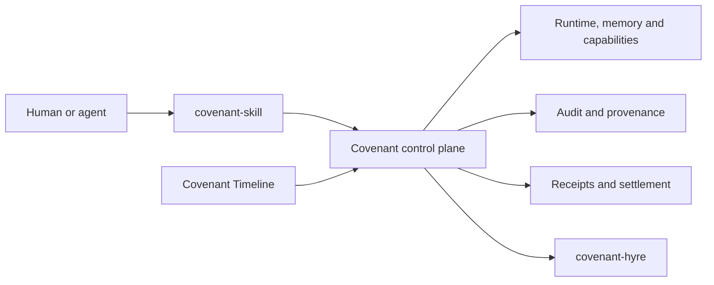

  

Open infrastructure for agent-native computing.

Covenant provides the state, authority, continuity, and accountability layer
for long-running software agents: scoped capabilities, durable memory, runtime
control, append-only audit, commit-scoped provenance, and settlement evidence.
Covenant Timeline extends that foundation with portable temporal contracts for
planning, replaying, evaluating, and governing work across time.

## Projects

| Project                                                                 | Purpose                                                                                                                   |
| ----------------------------------------------------------------------- | ------------------------------------------------------------------------------------------------------------------------- |
| [covenant](https://github.com/open-covenant/covenant)                   | Agent-native control plane, daemon, capabilities, memory, runtime, audit, provenance, SDKs, and settlement                |
| [covenant-timeline](https://github.com/open-covenant/covenant-timeline) | Temporal-contract specification, conformance suite, deterministic reference engine, and multidisciplinary domain profiles |
| [covenant-hyre](https://github.com/open-covenant/covenant-hyre)         | Hyre and x402 integration for metered agent services and delivery evidence                                                |
| [covenant-skill](https://github.com/open-covenant/covenant-skill)       | Agent skill for using Covenant's verifiable execution and settlement surfaces                                             |

## Current status

Covenant is alpha infrastructure. Its local control plane, capability lifecycle,
memory, audit, provenance, SDK, and several settlement surfaces are implemented
and tested. Production-grade isolation for hostile agent code, networked
multi-peer operation, and the complete daemon-driven economic lifecycle remain
active work.

Covenant Timeline is pre-alpha. Its current TypeScript package is an incubation
prototype while the language-neutral specification, conformance corpus,
deterministic kernel, and durable runtime are developed. It is not approved for
custody, unrestricted live trading, or human credit decisions.

Repository-specific READMEs and security documents define the exact boundary
for each project.

## Participate

- Start with the [Covenant architecture](https://github.com/open-covenant/covenant#architecture).
- Review the [Covenant Timeline program](https://github.com/open-covenant/covenant-timeline/blob/main/PROGRAM.md).
- Open focused issues and proposals in the relevant repository.
- Report vulnerabilities through the affected repository's private
  vulnerability-reporting channel. Do not open public security issues.

Website: [opencovenant.org](https://opencovenant.org)

Documentation: [docs.opencovenant.org](https://docs.opencovenant.org)
