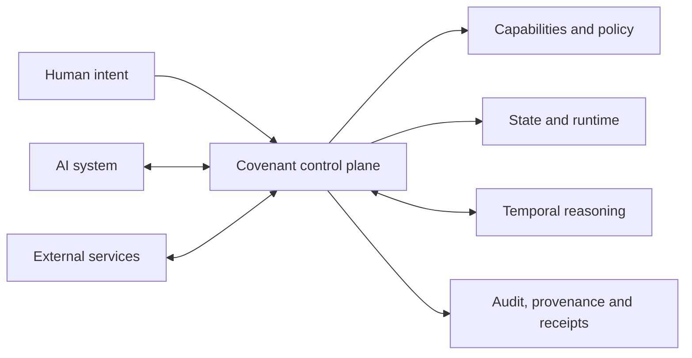

  

# Infrastructure for governed, long-running AI systems

Covenant is an open control and evidence layer for AI systems that operate over
extended periods. It turns human intent into scoped authority, durable state,
controlled execution, and verifiable records—so agents can continue work
without losing context or operating beyond their mandate.

[Website](https://opencovenant.org) ·
[Documentation](https://docs.opencovenant.org) ·
[Architecture](https://github.com/open-covenant/covenant#architecture)

## The Covenant platform

Long-running AI systems need more than access to tools. They need a durable way
to determine what may happen, preserve what has happened, recover across
interruptions, and prove why an action was allowed.

| Layer              | Capability                                                                        |
| ------------------ | --------------------------------------------------------------------------------- |
| Authority          | Issue, constrain, inspect, and revoke scoped capabilities                         |
| Continuity         | Preserve memory and execution state across sessions and restarts                  |
| Control            | Supervise runtime activity and route policy decisions                             |
| Accountability     | Produce append-only audit records, provenance, and settlement evidence            |
| Temporal reasoning | Represent and verify relationships among events, plans, forecasts, and hypotheses |

## Projects

| Project                                                                       | Purpose                                                                                                                 |
| ----------------------------------------------------------------------------- | ----------------------------------------------------------------------------------------------------------------------- |
| [Covenant](https://github.com/open-covenant/covenant)                         | Core control plane and daemon for capabilities, durable state, runtime control, audit, provenance, SDKs, and settlement |
| [Covenant Timeline](https://github.com/open-covenant/covenant-timeline)       | Proof-carrying temporal reasoning for events, plans, forecasts, hypotheses, and intervals                               |
| [Covenant Trust Layer](https://github.com/open-covenant/covenant-trust-layer) | Deterministic allow, review, and deny decisions with tamper-evident receipts                                            |
| [Covenant Plugin](https://github.com/open-covenant/covenant-plugin)           | Remote MCP access to Covenant identity, reputation, and attestation services                                            |
| [Covenant Skill](https://github.com/open-covenant/covenant-skill)             | Agent-facing workflows for verifiable execution and settlement                                                          |

## Temporal reasoning for AI systems

Time is not the order in which records arrive. Plans can precede execution,
observations can arrive late, forecasts can branch, and facts can remain valid
for only part of a process.

[Covenant Timeline](https://github.com/open-covenant/covenant-timeline) models
those distinctions explicitly. Draft v0alpha3 defines metric and ordinal time
axes; isolated actual, planned, forecast, and hypothetical contexts; and
evidence-bound points, intervals, coordinates, constraints, and facts.

Applications issue typed temporal queries and receive deterministic
conclusions—bounds, relations, or contradictions—with proof receipts that can
be checked independently of the reasoning call. The result is a portable
temporal state designed to be shared across models, runtimes, languages, and
workflows.

> **Status:** Timeline is experimental. Draft v0alpha3 is available in source
> under
> [RFC 0009](https://github.com/open-covenant/covenant-timeline/blob/main/rfcs/0009-temporal-reasoning-substrate.md).
> The current npm alpha provides checkpoint verification and does not expose
> the v0alpha3 reasoning API. See
> [Timeline release status](https://github.com/open-covenant/covenant-timeline#release-status)
> for the exact support and stability boundary.

[Explore Timeline](https://github.com/open-covenant/covenant-timeline) ·
[Read the vision](https://github.com/open-covenant/covenant-timeline/blob/main/docs/temporal-reasoning-vision.md) ·
[Integrate a model](https://github.com/open-covenant/covenant-timeline/blob/main/docs/model-interface.md)

## How the platform fits together

Covenant governs authority and continuity. Timeline makes temporal state
explicit and verifiable. Trust Layer produces deterministic policy receipts.
The plugin and skill expose these capabilities to agent runtimes and operator
workflows.

## Ecosystem adapters

Optional adapters connect Covenant to external identity, inference, data,
payment, settlement, and evidence systems while core contracts remain
provider-neutral. Review the
[implemented capabilities](https://github.com/open-covenant/covenant#capabilities)
and [repository documentation](https://github.com/open-covenant/covenant/tree/main/docs)
for each adapter's current support and deployment boundary.

## Maturity

Covenant is alpha infrastructure intended for evaluation, integration, and
contribution. The local control plane, capability lifecycle, durable memory,
audit and provenance surfaces, SDKs, and multiple settlement adapters are
implemented and tested.

Covenant is not yet positioned for hostile-code isolation or networked
multi-peer production deployment. Timeline remains a Draft, source-only surface
without independent operator or cross-implementation validation.

Each repository documents its exact guarantees, security model, and release
status.

## Get started

- **Operators and engineers:** evaluate the
  [live sandbox](https://sandbox.opencovenant.org), then follow the
  [Covenant quick start](https://github.com/open-covenant/covenant#quick-start).
- **Model and runtime teams:** begin with the
  [Timeline model interface](https://github.com/open-covenant/covenant-timeline/blob/main/docs/model-interface.md)
  and
  [temporal pilot](https://github.com/open-covenant/covenant-timeline/blob/main/docs/temporal-pilot.md).
- **Independent implementers:** review
  [RFC 0009](https://github.com/open-covenant/covenant-timeline/blob/main/rfcs/0009-temporal-reasoning-substrate.md)
  and the
  [conformance policy](https://github.com/open-covenant/covenant-timeline/blob/main/docs/policies/conformance.md).
- **Contributors:** open a focused issue or proposal in the relevant repository.
- **Security researchers:** use the affected repository's private vulnerability
  reporting channel. Do not disclose vulnerabilities in public issues.
