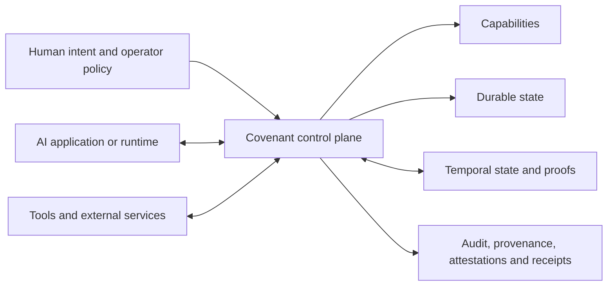

  

# Infrastructure for governed, long-running AI systems

Covenant gives AI systems scoped authority, durable state, runtime control, and
verifiable evidence for work that spans tools, sessions, and organizations.
Teams can define what a system may do, restore its state after interruption,
and trace consequential actions through durable records.

[Website](https://opencovenant.org) ·
[Documentation](https://docs.opencovenant.org) ·
[Core architecture](https://github.com/open-covenant/covenant#architecture) ·
[Live sandbox](https://sandbox.opencovenant.org)

## Platform capabilities

| Capability          | What it provides                                                                   |
| ------------------- | ---------------------------------------------------------------------------------- |
| Scoped authority    | Inspectable, revocable capabilities that define which actions a system may perform |
| Durable continuity  | Memory and execution state that survive session, worker, and process boundaries    |
| Runtime control     | Supervision, policy routing, and controlled access to tools and external services  |
| Verifiable evidence | Append-only audit records, provenance, attestations, and settlement receipts       |
| Temporal reasoning  | Queryable relationships among events, plans, forecasts, and hypotheses             |

## Projects

| Project                                                                       | Role                                                                                                           |
| ----------------------------------------------------------------------------- | -------------------------------------------------------------------------------------------------------------- |
| [Covenant](https://github.com/open-covenant/covenant)                         | Control plane and daemon for capabilities, state, runtime supervision, audit, provenance, SDKs, and settlement |
| [Covenant Timeline](https://github.com/open-covenant/covenant-timeline)       | Proof-carrying temporal reasoning for events, plans, forecasts, hypotheses, and intervals                      |
| [Covenant Trust Layer](https://github.com/open-covenant/covenant-trust-layer) | Deterministic allow, review, and deny decisions with tamper-evident receipts                                   |
| [Covenant Plugin](https://github.com/open-covenant/covenant-plugin)           | Remote MCP access to Covenant identity, reputation, and attestation services                                   |
| [Covenant Skill](https://github.com/open-covenant/covenant-skill)             | Agent-facing workflows for verifiable execution and settlement                                                 |

## Temporal reasoning for AI systems

[Covenant Timeline](https://github.com/open-covenant/covenant-timeline) gives
models and applications a portable representation of events, intervals, plans,
forecasts, and corrections. It distinguishes when a fact was valid from when
it was observed or recorded, so late evidence can update current reasoning
without changing earlier answers.

Typed queries return bounds, temporal relations, or contradictions with proof
receipts that another process can verify. The same temporal state can be shared
across models, runtimes, languages, and workflows.

Timeline v0alpha3 is available from source under
[Draft RFC 0009](https://github.com/open-covenant/covenant-timeline/blob/main/rfcs/0009-temporal-reasoning-substrate.md).
See
[Timeline release status](https://github.com/open-covenant/covenant-timeline#release-status)
for supported APIs and distribution channels.

[Explore Timeline](https://github.com/open-covenant/covenant-timeline) ·
[Read the vision](https://github.com/open-covenant/covenant-timeline/blob/main/docs/temporal-reasoning-vision.md) ·
[Integrate a model](https://github.com/open-covenant/covenant-timeline/blob/main/docs/model-interface.md)

## Architecture

Covenant manages authority, continuity, and controlled execution. Timeline
provides queryable temporal state and conclusions with machine-checkable
proofs. Trust Layer produces deterministic policy decisions and receipts. The
plugin, skill, and SDK surfaces connect these capabilities to applications,
agent runtimes, and operator workflows.

## Where Covenant fits

- **Software delivery:** constrain agent authority, retain state through
  restarts, and preserve the evidence behind review and release decisions.
- **Long-running operations:** coordinate work that spans workers, tools, and
  approval boundaries with a durable audit trail.
- **Research and analysis:** represent observations, validity periods,
  competing hypotheses, and later corrections as inspectable temporal state.
- **Governed workflows:** combine domain-owned policy and evidence with
  explicit capabilities, provenance, and deterministic verification.
- **AI platforms:** provide shared control and evidence services across models,
  runtimes, and application teams.

Provider-neutral interfaces support optional adapters for identity, inference,
data, payments, settlement, and evidence systems. The
[capability index](https://github.com/open-covenant/covenant#capabilities) and
[integration documentation](https://github.com/open-covenant/covenant/tree/main/docs)
describe each implemented surface.

## Evaluate Covenant

1. Explore the [live sandbox](https://sandbox.opencovenant.org).
2. Run the [Covenant quick start](https://github.com/open-covenant/covenant#quick-start)
   against a bounded local workflow.
3. Choose one bounded workflow and define the authority, state, and evidence it
   must preserve.
4. Integrate through the relevant SDK, plugin, skill, or model interface.
5. Test revocation, restart recovery, and evidence replay under the deployment
   policy.

Model and runtime teams can start with the
[Timeline model interface](https://github.com/open-covenant/covenant-timeline/blob/main/docs/model-interface.md)
and [executable temporal pilot](https://github.com/open-covenant/covenant-timeline/blob/main/docs/temporal-pilot.md).
Independent implementers can use
[RFC 0009](https://github.com/open-covenant/covenant-timeline/blob/main/rfcs/0009-temporal-reasoning-substrate.md)
and the
[conformance policy](https://github.com/open-covenant/covenant-timeline/blob/main/docs/policies/conformance.md).

## Release maturity

Covenant is alpha infrastructure for evaluation, integration, and contribution.
The local control plane, capability lifecycle, durable memory, audit and
provenance surfaces, SDKs, and settlement adapters are implemented and tested.
Timeline v0alpha3 is available from source for technical evaluation; its API
remains Draft.

Before production or high-stakes use, review the selected component's release
status, security model, and deployment requirements.

## Participate

Open focused issues and proposals in the relevant repository. Security
researchers should use that repository's private vulnerability-reporting
channel.
