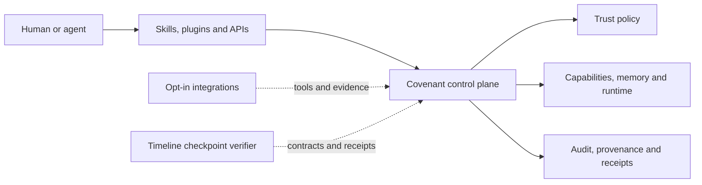

<p align="center">
  
</p>

Open infrastructure for agent-native computing.

Covenant provides the state, authority, continuity, and accountability layer
for long-running software agents: scoped capabilities, durable memory, runtime
control, append-only audit, commit-scoped provenance, and settlement evidence.

## Projects

| Project                                                                       | Purpose                                                                                                    |
| ----------------------------------------------------------------------------- | ---------------------------------------------------------------------------------------------------------- |
| [covenant](https://github.com/open-covenant/covenant)                         | Agent-native control plane, daemon, capabilities, memory, runtime, audit, provenance, SDKs, and settlement |
| [covenant-timeline](https://github.com/open-covenant/covenant-timeline)       | Portable checkpoint contracts, deterministic replay, evidence profiles, and run verification               |
| [covenant-trust-layer](https://github.com/open-covenant/covenant-trust-layer) | Deterministic allow, review, and deny decisions with tamper-evident receipts                               |
| [covenant-plugin](https://github.com/open-covenant/covenant-plugin)           | Remote MCP access to Covenant identity, reputation, and attestation checks                                 |
| [covenant-skill](https://github.com/open-covenant/covenant-skill)             | Agent skill for Covenant's verifiable execution and settlement surfaces                                    |

## Covenant Timeline

[Covenant Timeline](https://github.com/open-covenant/covenant-timeline) is a
published alpha checkpoint-contract format and verifier for long-running agent
and software work. It deterministically replays ordered evidence, checkpoint
decisions, effect requests, and receipts. The released v0alpha1 package records
an external evaluator's policy label; the source-only v0alpha2 schema binds
profile and policy identity in the contract.

The repository now includes a collector-signed GitHub software-delivery
profile, a public five-day run archive, a Temporal adapter tested across a
worker restart, and a Python reducer matching the TypeScript conformance corpus.
Covenant remains the first reference adopter. Independent external operation is
still the adoption gate.

Install the released package with:

```sh
npm install @covenant-org/timeline@0.0.0-alpha.1
```

Timeline is not a distributed workflow runtime, a universal scoring system, or
a production authorization service.



## Documented integrations

Integrations are opt-in adapters around Covenant's generic capability, audit,
identity, and payment primitives. No partner-specific adapter defines
Covenant's architecture. In particular, x402 is implemented in Covenant core;
Hyre is one provider profile on top of that rail.

| Integration                                                                                                       | Covenant surface                                                                 |
| ----------------------------------------------------------------------------------------------------------------- | -------------------------------------------------------------------------------- |
| [x402 and PayAI](https://github.com/open-covenant/covenant/blob/main/docs/x402.md)                                | Generic inbound and outbound paid HTTP, with PayAI-facilitated Solana settlement |
| [AceData](https://github.com/open-covenant/covenant/blob/main/docs/integrations/acedata.md)                       | Generative tools with capability gates and provenance                            |
| [Circuit](https://github.com/open-covenant/covenant/tree/main/agent-os/crates/covenant-circuit)                   | Paid inference and data tools                                                    |
| [ENS](https://github.com/open-covenant/covenant/tree/main/agent-os/crates/covenant-ens-gateway)                   | CCIP-Read projection of Covenant identities to `*.agents.opencovenant.eth`       |
| [Hyre](https://github.com/open-covenant/covenant-hyre)                                                            | Provider-specific catalog and MCP tools over the generic x402 gateway            |
| [Krexa](https://github.com/open-covenant/covenant/blob/main/docs/integrations/krexa.md)                           | Credit and risk signals kept separate from Covenant-derived reputation           |
| [MagicBlock](https://github.com/open-covenant/covenant/blob/main/docs/magicblock-integration.md)                  | Ephemeral Rollup verification, provenance, and bonds                             |
| [Metaplex](https://github.com/open-covenant/covenant/blob/main/docs/metaplex-integration.md)                      | MPL Core identity and attestations                                               |
| [SNS](https://github.com/open-covenant/covenant/tree/main/agent-os/crates/covenant-sns)                           | Read-only `.sol` identity profile                                                |
| [Synapse Agent Protocol](https://github.com/open-covenant/covenant/tree/main/agent-os/crates/covenant-sap-bridge) | Opt-in publication bridge for agents, audit roots, and attestations              |
| [zauth](https://github.com/open-covenant/covenant/blob/main/docs/zauth.md)                                        | x402 provider discovery, health monitoring, and RepoScan                         |

## Current status

Covenant is alpha infrastructure. Its local control plane, capability lifecycle,
memory, audit, provenance, SDK, and several settlement surfaces are implemented
and tested. Production-grade isolation for hostile agent code, networked
multi-peer operation, and the complete daemon-driven economic lifecycle remain
active work.

Covenant Timeline has a published v0alpha1 TypeScript package and CLI, canonical
byte identity, a landed Covenant adapter, source-only v0alpha2 policy binding,
authenticated GitHub evidence, durable reference storage, a restart-tested
Temporal adapter, and a second-language reducer. It has not yet demonstrated
independent external operation, production deployment evidence, stable SDK
compatibility, or independently maintained implementation governance.

Repository-specific READMEs and security documents define the exact boundary
for each project.

## Participate

- Start with the [Covenant architecture](https://github.com/open-covenant/covenant#architecture).
- Try the [Covenant Timeline alpha](https://github.com/open-covenant/covenant-timeline#install-the-released-alpha).
- Review the [Covenant Timeline program](https://github.com/open-covenant/covenant-timeline/blob/main/PROGRAM.md).
- Open focused issues and proposals in the relevant repository.
- Report vulnerabilities through the affected repository's private
  vulnerability-reporting channel. Do not open public security issues.

Website: [opencovenant.org](https://opencovenant.org)

Documentation: [docs.opencovenant.org](https://docs.opencovenant.org)
